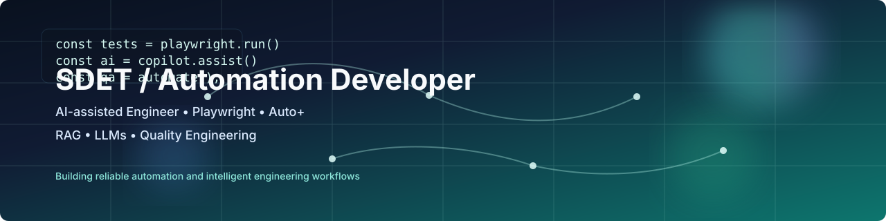

# Lava (lavakumartetali) — Test Engineer & Automation Developer

## One‑line
Test Engineer • Automation Developer — 4+ years building Playwright & Auto+ automation, Python tooling, and AI‑assisted engineering solutions (RAG / LLM).

---

## About
I deliver reliable, scalable test automation and AI‑assisted engineering tools that reduce manual effort and accelerate delivery. My work includes Playwright JavaScript suites for web apps, Auto+ solutions for Win32 and Microsoft Store applications, and Python tooling for CI/PR automation and RAG pipelines. I prioritize measurable automation coverage, reproducible demos, and clear engineering documentation.

---

## Select Achievements
- Reduced manual regression time by expanding automation coverage with reusable Playwright suites.  
- Built Python utilities to automate pull request validation and bulk code migration across automation projects.  
- Implemented AI‑assisted workflows (Copilot + MCP + RAG) that speed up test creation and maintenance.  
- Recognized with Inspiring Performance, Best Newcomer, and Execution Excellence awards.

---

## Core Skills (keywords for ATS / recruiters)
Playwright • Auto+ • JavaScript • Python • RAG • LLMs • Git • Azure DevOps • CI/CD • WebSockets • Windows (ARM64, x64) • Test Automation • Regression Testing • Functional Testing • Test Case Design • Selenium / Playwright examples • Automation frameworks

---

## Experience (highlight)
Test Engineer / Automation Developer — Wipro Limited, Hyderabad (Sep 2021 – Present)
- Developed and maintained Playwright automation scripts and reusable Auto+ UI automation solutions for desktop & store apps.
- Validated compatibility across ARM64, Intel x64 and AMD systems; executed end‑to‑end functional and regression testing.
- Built Python automation tools for PR validation, bulk migration, and CI checks; logged and tracked defects using Azure DevOps.
- Delivered RAG PoCs and Streamlit apps to support document retrieval and LLM-driven responses for engineering workflows.

---

## Education
M.Tech (Computer Science), BITS Pilani (WILP), Hyderabad — 2021–2025

---

## Selected Projects
- RAGFlow — end‑to‑end RAG in browser: https://github.com/lavakumartetali/RAGFlow  
- KSpectra — realtime network monitoring dashboard: https://github.com/lavakumartetali/KSpectra  
- Noyra — AI learning assistant: https://github.com/lavakumartetali/Noyra-AI-Learning-Assistant  
- PhishNix — email risk analyzer: https://github.com/lavakumartetali/Email-risk-analyzer-phishnix  
- TestLab — automation playground: https://github.com/lavakumartetali/TestLab

---

## Contact
- GitHub: https://github.com/lavakumartetali  
- Portfolio: https://lavakumartetali.github.io  
- Email: you@example.com  (replace with preferred contact)

---

## Hiring / Collaboration
Open to roles in Test Automation, QA Engineering, SDET, Automation Development, and AI‑driven engineering tooling. I prefer positions where I can design automation strategy, mentor engineers, and introduce AI‑assisted workflows to accelerate delivery.
